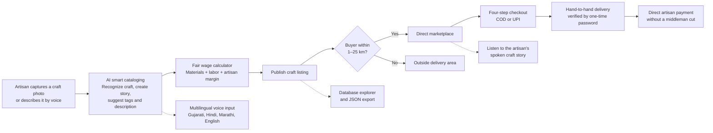

🪔 Artisans360: AI-Driven Market Linkage & Smart Cataloging for Marginalized Artisans

🔗 **Live Website:** [Open Artisans360](http://127.0.0.1:5500/)

📌 Executive Summary

Traditional artisans across rural India—specializing in heritage crafts like
Pure Gaji Silk Bandhani, Tapi Riverbed Terracotta Pottery, Rabari Mirror-Work
(Abhala Toran), Kutch Organic Handloom, Sankheda Lacquered Woodcraft, and Nirona
Copper Bells—face two systemic barriers:

1.  The Digital Literacy Barrier: Complex e-commerce seller portals require
typing, metadata entry, and computer literacy that non-literate or
vernacular-speaking artisans lack.
2.  The Middleman & Logistics Exploitation: Intermediaries claim 40%–70% of
    craft sale margins, while buyers have no guarantee of authenticity or direct
    lineage to the master artisan.

Artisans360 solves this with a zero-typing, voice-controlled, multimodal
cataloging studio combined with a hyperlocal 25 km direct-to-consumer delivery
and marketplace linkage engine.

💡 Key Innovations & Core Modules

The diagram below shows how an artisan's craft moves from cataloging to direct
sale and OTP-verified delivery.



1. 📸 Multimodal "Snap & Sell" AI Smart Cataloging

  - Instant Craft Recognition: Artisans capture or upload a craft photo; the
    system automatically extracts the craft domain, generates rich cultural
    storytelling copy, assigns tags, and suggests descriptions.
  - Fair Price & Wage Recommendation: Automatically calculates fair consumer
    pricing based on transparent breakdowns:
    \text{Fair Price} = \text{Raw Material Cost} + (\text{Labor Hours} \times \text{Fair Hourly Wage}) + \text{Artisan Margin}
    (e.g., Silk Bandhani: ₹320 Materials + 12 Hours Tying @ ₹530 = ₹850 direct
    artisan payout).

2. 🎙️ Multilingual Voice Engine & Audio Stories

  - Voice-Guided Listings: Artisans can speak in Gujarati (gu-IN), Hindi
    (hi-IN), Marathi (mr-IN), or English (en-IN) via the Web Speech Recognition
    API.
  - Artisan Story Audio Player: Buyers can listen to authentic spoken audio
    stories directly on craft cards, learning the provenance, cluster lineage,
    and raw materials used.

3. 🛒 4-Step Direct Checkout with OTP Delivery

  - Complete E-Commerce Flow: Multi-item cart management, address selection for
    campuses and rural clusters, COD / direct UPI selection, and live order
    tracking.
  - Privacy-Preserving Logistics: Delivery partners (e.g., Ramesh Patel -
    GJ-19-BK-4022) receive physical coordinates only upon dispatch. Delivery is
    finalized strictly upon verifying a 4-digit one-time password (OTP).

4. 🗄️ Real-Time Database Explorer & Audit Engine

  - Includes an interactive schema inspector displaying structured tables for
    Craft Catalogs, Live Orders & OTPs, and Artisan Profiles, with 1-click JSON
    database export.

🏺 Supported Heritage Craft Clusters (Gujarat 25 km Pilot)

| Cluster & Distance               | Master Artisan     | Heritage Craft Specialization     | Technique & Material                                                             |
| :------------------------------- | :----------------- | :-------------------------------- | :------------------------------------------------------------------------------- |
| **Khatri Weavers (6.5 km)**      | Geetaben Khatri    | Pure Gaji Silk Bandhani Dupatta   | Traditional Khatri finger-tying (5,000+ micro *bindis*), natural madder & indigo |
| **Ten Village Cluster (4.5 km)** | Kanubhai Prajapati | Terracotta Clay Jug & Tumbler     | Tapi riverbed alluvial clay, hand-thrown wheel, wood-kiln fired                  |
| **Rabari Colony (8.0 km)**       | Jiviben Rabari     | Peacock Mirror-Work Wall Hanging  | Authentic *Abhala* glass mirrors, khadi canvas, hand-embroidered tassels         |
| **Kutch Handloom Guild (14 km)** | Deviben Vankar     | Organic Cotton Heritage Saree     | Traditional wooden pit-looms, extra-weft weaving, organic plant dyes             |
| **Sankheda Woodcraft (18 km)**   | Rameshbhai Suthar  | Lacquered Teakwood Dandiya Sticks | Wood lathe turning, natural tree shellac, tin-foil floral motifs                 |
| **Nirona Smithy (11.5 km)**      | Husain Luhar       | Tuned Rustic Copper Wind Bells    | Scrap iron mud-coated in copper/brass, ear-tuned, zero welding                   |

🛠️ Technology Stack

  - Frontend: HTML5 Semantic Markup, Tailwind CSS, Lucide Icons, Vanilla
    JavaScript (ES6+)
  - Voice AI & Speech: Web Speech Recognition API (webkitSpeechRecognition), Web
    SpeechSynthesis API (Native browser TTS with Indian accent profile support)
  - Backend: Node.js HTTP REST Server (Zero external dependencies)
  - Database & Persistence: Structured JSON document store with local file
    fallback (data/artisans360_database.json) & browser localStorage client sync
  - Architecture: Static deployable, lightweight client-server architecture

📁 Repository Structure

```text
PR-ARTISAN360/
├── README.md
├── Run-Artisans360.bat
├── app.js
├── db.js
├── index.html
├── server.js
├── images/
│   ├── bandhani.jpg
│   ├── copperbells.jpg
│   ├── dandiya.jpg
│   ├── logo.jpg
│   ├── pottery.jpg
│   ├── saree.jpg
│   └── wallhanging.jpg
└── data/                          (created automatically when the server starts)
    └── artisans360_database.json  (initialized by the database module)
```

🚀 Quickstart & Setup Guide

### Prerequisites

- Node.js (v16.0.0 or higher recommended)
- Any modern web browser (Google Chrome or Microsoft Edge recommended for full
  Speech API support)

### Option 1: 1-Click Launch (Windows)

Double-click `Run-Artisans360.bat`. It will start the server and open
[http://localhost:3000](http://localhost:3000) automatically in your default
browser.

### Option 2: Terminal / Command Line

1. Clone the repository:

   ```bash
   git clone https://github.com/np8-ai/PR-ARTISAN360.git
   cd PR-ARTISAN360
   ```

2. Start the local server:

   ```bash
   node server.js
   ```

3. Open [http://localhost:3000](http://localhost:3000) in your browser.

You can also open `index.html` directly in your browser. In offline mode, the
client gracefully falls back to browser-managed localStorage.

🔌 REST API Endpoints

| Method   | Endpoint            | Description                                                             |
| :------- | :------------------ | :---------------------------------------------------------------------- |
| `GET`    | `/api/products`     | Retrieve all active handcrafted listings                                |
| `POST`   | `/api/products`     | Publish a new craft (via AI Studio or manual entry)                     |
| `DELETE` | `/api/products/:id` | Remove a craft listing                                                  |
| `GET`    | `/api/orders`       | Retrieve order records and delivery OTP statuses                        |
| `POST`   | `/api/orders`       | Submit a new order with client details, payment type, and generated OTP |
| `GET`    | `/api/dump`         | Full database export (Crafts, Artisans, Orders, Messages)               |
| `GET`    | `/api/stats`        | Real-time counts of crafts, orders, and cluster nodes                   |

👥 Team HeritageCoders (SIH 2026)

📄 License & Attribution

Developed for Smart India Hackathon (SIH). Distributed under the MIT License.
All craft imagery and cultural motifs represent genuine Gujarati traditional
craft heritage.
